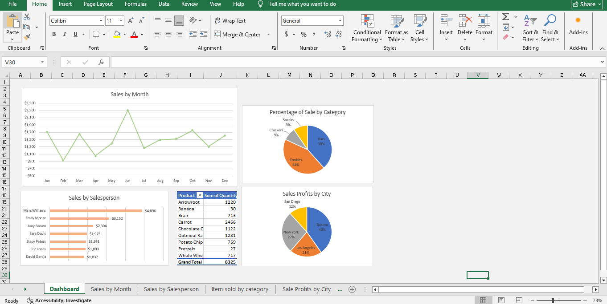

# Excel Sales Dashboard

## Project Overview

This project focuses on analyzing sales performance using Microsoft Excel. An interactive dashboard was developed to transform sales data into meaningful visual insights, helping users understand monthly sales trends, product category performance, salesperson contributions, and city-level profit distribution.

## Dashboard Preview

## Business Objectives

- Analyze monthly sales performance and identify sales trends.
- Compare sales contributions across product categories.
- Evaluate individual salesperson performance.
- Understand product quantities sold.
- Analyze profit distribution across different cities.

## Dashboard Features

### 1. Sales by Month
A line chart displaying monthly sales trends from January to December.

### 2. Percentage of Sales by Category
A pie chart showing the percentage contribution of each product category:
- Cookies: 44%
- Bars: 38%
- Crackers: 9%
- Snacks: 9%

### 3. Sales by Salesperson
A horizontal bar chart comparing sales performance across individual salespeople.

### 4. Items Sold by Category
A summary table displaying product quantities sold, with a total of 8,325 units.

### 5. Sales Profits by City
A pie chart illustrating the distribution of profits across four cities:
- Boston: 40%
- New York: 27%
- Los Angeles: 21%
- San Diego: 12%

## Tools & Skills

- Microsoft Excel
- Data Cleaning and Preparation
- Pivot Tables
- Data Visualization
- Sales Performance Analysis
- Business Intelligence

## Project Files

- `sales_chartsanddashboards (1).xlsx` – Excel workbook containing the sales dashboard and analysis.
- `dashboard_screenshot.PNG` – Dashboard preview.

## Key Takeaway

This project demonstrates how Microsoft Excel can be used to organize sales data, create meaningful visualizations, and communicate business performance insights through an interactive dashboard.
